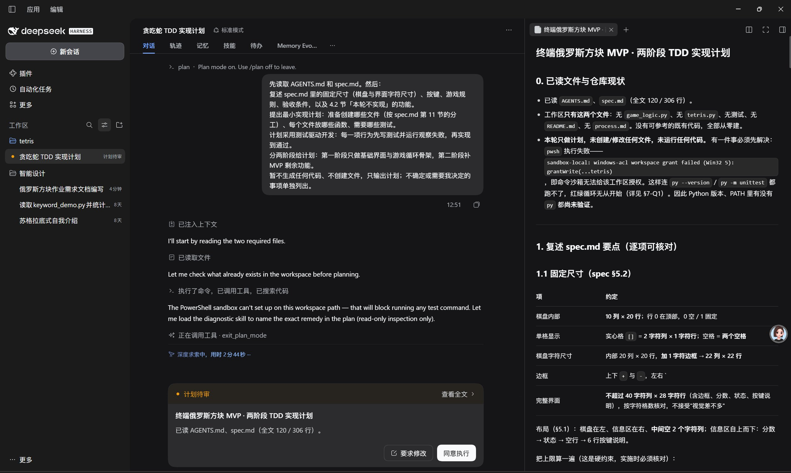
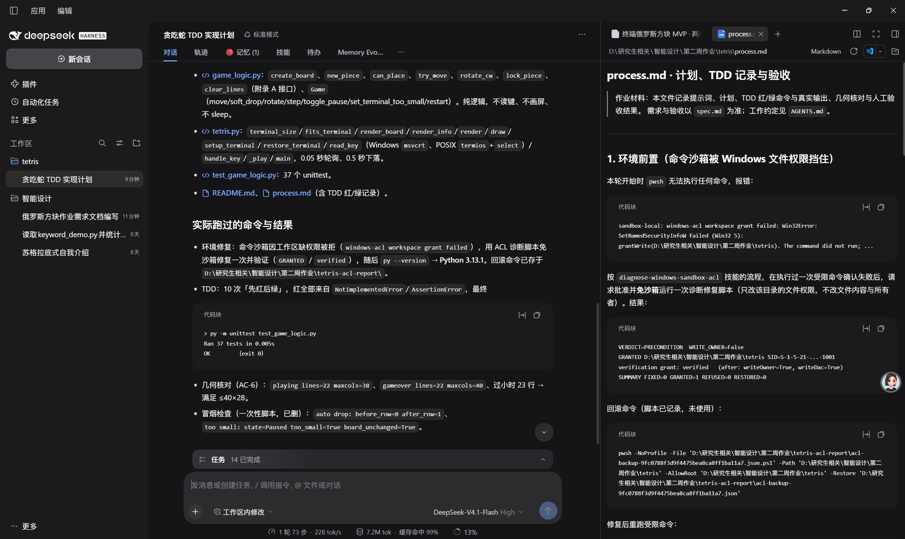
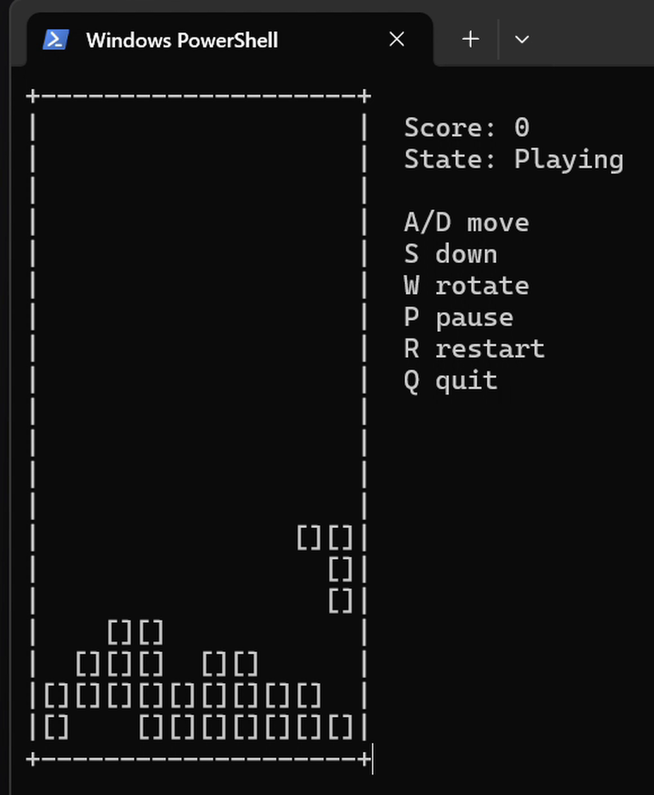
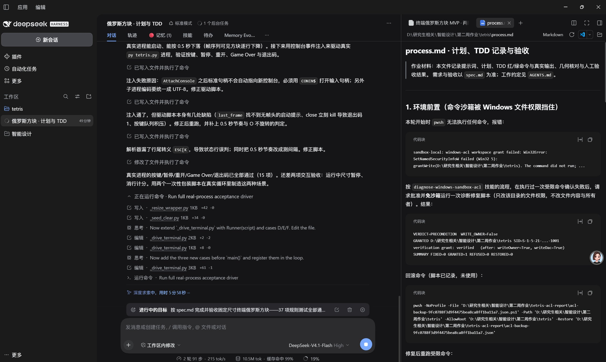

# process.md · 计划、TDD 记录与验收

> 作业材料：本文件记录提示词、计划、TDD 红/绿命令与真实输出、几何核对与人工验收结果。
> 需求与验收以 `spec.md` 为准；工作约定见 `AGENTS.md`。

---

## 1. 环境前置（命令沙箱被 Windows 文件权限挡住）

本轮开始时 `pwsh` 无法执行任何命令，报错：

```
sandbox-local: windows-acl workspace grant failed: Win32Error: SetNamedSecurityInfoW failed (Win32 5):
grantWrite(D:\研究生相关\智能设计\第二周作业\tetris). The command did not run; ...
```

按 `diagnose-windows-sandbox-acl` 技能的流程，在执行过一次受限命令确认失败后，请求批准并**免沙箱**运行一次诊断修复脚本（只改该目录的文件权限，不改文件内容与所有者）。结果：

```
VERDICT=PRECONDITION  WRITE_OWNER=False
GRANTED D:\研究生相关\智能设计\第二周作业\tetris SID=S-1-5-21-...-1001
verification grant: verified   (after: writeOwner=True, writeDac=True)
SUMMARY FIXED=0 GRANTED=1 REFUSED=0 RESTORED=0
```

回滚命令（脚本已记录，未使用）：

```
pwsh -NoProfile -File 'D:\研究生相关\智能设计\第二周作业\tetris-acl-report\acl-backup-9fc0788f3d9f4475bea8ca8ff1ba11a7.json.ps1' -Path 'D:\研究生相关\智能设计\第二周作业\tetris' -AllowRoot 'D:\研究生相关\智能设计\第二周作业\tetris' -Restore 'D:\研究生相关\智能设计\第二周作业\tetris-acl-report\acl-backup-9fc0788f3d9f4475bea8ca8ff1ba11a7.json'
```

修复后重跑受限命令：

```
> py --version; py -c "import sys; print(sys.version)"
Python 3.13.1
3.13.1 (tags/v3.13.1:0671451, Dec  3 2024, 19:06:28) [MSC v.1942 64 bit (AMD64)]
```

## 2. 阶段提示词（用户原文）

> 先读取 AGENTS.md 和 spec.md。然后：复述 spec.md 里的固定尺寸（棋盘与界面字符尺寸）、按键、游戏规则、验收条件，以及 4.2 节「本轮不实现」的功能。
> 提出最小实现计划：准备创建哪些文件（按 spec.md 第 11 节的分工）、每个文件放哪些函数、需要哪些测试。
> 计划采用测试驱动开发：每一项行为先写测试并运行观察失败，再实现到通过。
> 分两阶段给计划：第一阶段只做基础界面与游戏循环骨架，第二阶段补 MVP 剩余功能。
> 暂不生成任何代码、不创建文件，只输出计划；不确定或需要我决定的事项单独列出。



## 3. 计划要点（审阅结论：保留）

- **尺寸**：棋盘内部 10×20，单格 `[]`（2 列 × 1 行），棋盘字符 22×22，完整界面 ≤ 40×28。
  宽度核算：22（棋盘）+ 2（间隔）+ 16（`State: Game Over`）= 恰好 40 → 每行必须裁掉尾随空格；高度 22 行 ≤ 28。
- **文件分工**（spec §11）：`game_logic.py`（纯逻辑）、`tetris.py`（显示/按键/循环）、`test_game_logic.py`（unittest）、`README.md`、`process.md`。
- **两阶段**：
  - 阶段一（S1–S7）：红脚手架 → 棋盘 → 七种方块与出生位置 → 移动/边界/重叠 → 软降与自动下落 → 固定/重生/结束 → 界面与循环骨架。
  - 阶段二（S8–S12）：旋转 R2/FR-5 → 消行与计分（附录 A）→ 暂停 FR-11 → 运行中尺寸不足 FR-9 → 重开 FR-12。
  - 收尾（S13）：README、本文件、人工验收。
- **已确认的默认决策**：方块到底后按 S 触发固定（与 6.5 同一条路径）；终端过小时只响应 Q；尺寸提示用 spec 中文原文；§5.1 样例图按示意图处理、以 §5.2 的 22 行为准；界面几何用一次性命令核对，不新增测试文件。

**审阅结论：保留原计划，不调整。** 理由：阶段一（界面与循环骨架）与阶段二（旋转、消行计分、暂停、尺寸不足、重开）正好逐项覆盖 spec §4.1 的 MVP，文件分工与 §11 一致，计划中没有出现任何 §4.2 的非目标功能；"先写测试、看到失败再实现"的顺序也落到了每一步。唯一需要留痕的解释是最后一条决策：spec 6.5 只写了"不能下移则固定"，计划把"按 S 且已无法下移"归入同一条下落路径，实现照此执行。



## 4. TDD 记录（命令、红、绿）

统一命令（Windows）：

```
py -m unittest test_game_logic.py
```

红阶段要求失败来自"功能尚未实现"（`NotImplementedError` / `AssertionError`），不接受 ImportError。

| 步骤 | 新增测试 | 红（实际输出摘要） | 绿 |
| --- | --- | --- | --- |
| S1 脚手架 | 棋盘尺寸 | `NotImplementedError: create_board`；`Ran 1 test ... FAILED (errors=1)`，exit 1 | — |
| S2 棋盘 | 同上 | — | `Ran 1 test ... OK`，exit 0 |
| S3 方块 | 七种方块出生格、中心格、随机选择 | `NotImplementedError: new_piece`；子测试 15 项；`FAILED (errors=15)`，exit 1 | `Ran 4 tests ... OK` |
| S4 移动 | 左右移动、左右墙拒绝、重叠拒绝 | `NotImplementedError: Game.__init__`；`FAILED (errors=4)`，exit 1 | `Ran 8 tests ... OK` |
| S5 下落 | S 下移一行、自动下落一行 | `NotImplementedError: Game.soft_drop` / `Game.step`；`FAILED (errors=2)`，exit 1 | `Ran 10 tests ... OK` |
| S6 固定/重生/结束 | 落地固定、重生、Game Over、结束后按键无效 | `NotImplementedError: Game._lock_and_clear`；`FAILED (errors=4)`，exit 1 | `Ran 14 tests ... OK` |
| S7 界面骨架 | —（界面不写单测，见 §5） | — | 14 tests OK；几何核对见 §5 |
| S8 旋转 | T/I 顺时针、O 空操作、贴墙取消、被挡取消、连转 4 次复原、结束后忽略 | `NotImplementedError: Game.rotate`；`FAILED (errors=7)`，exit 1 | `Ran 21 tests ... OK` |
| S9 消行计分 | 附录 A 的 A/B/C/D、不改入参、保持 20×10、单行 +100、F 例 100+200=300 | `NotImplementedError: clear_lines`（6 errors）+ `AssertionError: 0 != 100`、`100 != 300`（2 failures）；`FAILED (failures=2, errors=6)`，exit 1 | `Ran 29 tests ... OK` |
| S10 暂停 | P 暂停后 A/D/S/W 无效、再按 P 恢复可下落 | `NotImplementedError: Game.toggle_pause`；`FAILED (errors=2)`，exit 1 | `Ran 31 tests ... OK` |
| S11 尺寸不足 | 缩小暂停/恢复继续、手动暂停保持、过小时 P 无效 | `NotImplementedError: Game.set_terminal_too_small`；`FAILED (errors=3)`，exit 1 | `Ran 34 tests ... OK` |
| S12 重开 | Playing / Paused / Game Over 三态重开 | `NotImplementedError: Game.restart`；`FAILED (errors=3)`，exit 1 | `Ran 37 tests ... OK` |

最终一次全量运行：

```
> py -m unittest test_game_logic.py
.....................................
----------------------------------------------------------------------
Ran 37 tests in 0.005s

OK
（exit 0）
```

> 初步测试的实跑输出即上方这次 `Ran 37 tests ... OK`，画面见 §2 图 2 下半部分；基础界面见 §5 图 3。

## 5. 界面：真实截图与几何核对（AC-6）



```
> py -c "import game_logic, tetris; g=game_logic.Game(); ls=tetris.render(g); print('lines=%d maxcols=%d' % (len(ls), max(map(len, ls))))"
playing lines=22 maxcols=38

> py -c "... g.state=game_logic.GAME_OVER ..."
gameover lines=22 maxcols=40

> py -c "... g.set_terminal_too_small(True) ..."
toosmall lines=23
```

- 棋盘每行 22 字符（`board_line_widths=[22]`），信息区压在前 9 行，总高 22 行。
- 最坏宽度 40（`State: Game Over`）≤ 40；高度 22（过小时 23，多一行提示）≤ 28。
- 过小时那一行提示为中文，按字符宽度会超过 40 列，但此时终端本身就小于 40×28，属于 spec 5.4 要求的提示场景，不影响正常界面 ≤40×28 的结论。

## 6. 循环冒烟检查（不启动真实终端）

用一次性脚本（运行后已删除）替换 `read_key` / `terminal_size` / `draw` / 时钟，驱动 `tetris._play`：

```
dispatch: state=Playing score=0 piece=True
auto drop: before_row=0 after_row=1
too small: state=Paused too_small=True board_unchanged=True
（exit 0）
```

含义：A/D/S/W/P/R/Q 分发不报错、0.65 秒假时钟推进后自动下落 1 行、终端缩到 30×20 时状态转 `Paused` 且 A/P 键不改变棋盘、只有 Q 能退出。

## 7. 第二阶段：Goal 模式与真实终端进程验收

### 7.1 Goal 目标（会话内创建）

在同一个会话里把完成条件写成可判定的 Goal（`goal-f4f4da60-…`，Round 1/256，验收通过后标记 complete），目标原文：

> 按 spec.md 完成并验收固定尺寸终端俄罗斯方块——37 项规则测试全部通过，并在真实终端跑通一局到 Game Over。 先重新读取 AGENTS.md 和 spec.md，复述尚未完成的项（真实终端交互验收）。然后在真实终端运行 py tetris.py，逐项验证 A/D/S/W/P/R/Q、0.5 秒下落、消行计分、Game Over、缩小暂停与恢复；发现的问题当场修，修完重跑 py -m unittest test_game_logic.py；报告实际命令、实际输出与未覆盖项，不伪造结果。



### 7.2 真实终端进程验收（真实控制台 + 注入按键）

机器上无人按键，因此用一次性脚本驱动真实的 `py tetris.py` 进程：

- 子进程用 `CREATE_NO_WINDOW` 创建自己的控制台，游戏里 `msvcrt.kbhit/getwch` 读的正是这个控制台的输入缓冲区；
- 父进程 `AttachConsole(pid)` 后用 `CreateFileW("CONIN$")` 取输入句柄，再 `WriteConsoleInputW` 注入真实的 `KEY_EVENT`；
- 子进程 stdout 仍是管道，于是能逐帧收下 ANSI 输出，按帧断言状态行、棋盘格与分数。

实测输出（`py _drive_terminal.py`，退出码 0）：

```text
=== case_startup_too_small ===
[PASS] A1 启动尺寸不足有提示  子进程输出中文提示
[PASS] A2 提示后按 Q 退出  退出码=0

=== case_keys ===
[PASS] B1 正常启动显示 Playing  首屏 State: Playing
[PASS] B2 按 S 立即下移一行  棋盘画面已变化
[PASS] B3 按 A 左移  棋盘画面已变化
[PASS] B4 按 W 旋转  方块形状已变化（中心格不变）
[PASS] B5 按 P 进入 Paused  状态行 State: Paused
[PASS] B6 暂停时按键不改变棋盘  棋盘画面保持不变
[PASS] B7 再按 P 继续且自动下落  状态回到 Playing 且方块继续下落
[PASS] B8 按 R 重开  回到 Playing 且分数 0
[PASS] B9 自动下落约 0.5 秒一次  第 1 次下落=0.02s，后续间隔=[0.49, 0.51, 0.51, 0.49, 0.52]
[PASS] B10 按 Q 退出码为 0  退出码=0

=== case_resize_shrink_restore ===
[PASS] D1 运行中缩小→Paused  状态行 State: Paused
[PASS] D2 恢复尺寸→自动 Playing  状态行 State: Playing
[PASS] D3 退出码为 0  退出码=0

=== case_resize_manual_pause ===
[PASS] E1 手动按 P 暂停  状态行 State: Paused
[PASS] E2 手动暂停后缩小再恢复仍 Paused  状态行=Paused
[PASS] E3 再按 P 才继续  状态行 State: Playing
[PASS] E4 退出码为 0  退出码=0

=== case_line_clear_score ===
[PASS] F1 补满底行后消行计分  界面出现 Score: 100
[PASS] F2 退出码为 0  退出码=0

=== case_game_over ===
[PASS] C1 连续软降堆到 Game Over  状态行 State: Game Over
[PASS] C2 Game Over 后按 R 重开  回到 Playing 且分数 0
[PASS] C3 退出码为 0  退出码=0
```

各用例做了什么、哪里是"模拟"（不隐瞒）：

- **A**：不设 `COLUMNS/LINES`，`shutil.get_terminal_size()` 回退 80×24（<28 行）→ 走启动尺寸不足分支，注入 Q 后退出码 0（FR-9 启动、FR-10）。
- **B**：设 40×28 正常启动，逐键注入 S/A/W/P/D/R/Q。B9 从重开时刻起采样棋盘变化，实测相邻两次下落 0.49–0.52 秒（FR-2/FR-4）；B5–B7 覆盖 FR-11 与 AC-7；B8 覆盖 FR-12。
- **D/E**：真实循环 + 真实按键，但**尺寸来源用 `COLUMNS/LINES` 模拟**（包装脚本按时间线改环境变量，这正是 `shutil.get_terminal_size()` 优先读取的来源）：1.8 秒缩到 30×20、3.0 秒恢复 60×30。D 验证缩小→Paused、恢复→Playing；E 验证"缩小前手动暂停，恢复后仍 Paused，需再按 P"（spec 5.4 最后一条）。**真实拖动窗口仍需人工确认。**
- **F**：为制造消行，包装脚本在进入循环前把棋盘底行除当前方块最底行列以外全部填满，方块直落补满整行，界面出现 `Score: 100`（FR-7 的界面侧证据）。棋盘预置只发生在验收脚本里，生产代码未改。
- **C**：连续注入 S 把方块堆到顶，状态转 `Game Over`；注入 R 回到 Playing 且分数 0；注入 Q 退出码 0（FR-8/FR-12/FR-10）。

脚本 `_drive_terminal.py`、`_resize_wrapper.py`、`_seed_clear.py` 都是一次性验收工具，运行后已删除；生产文件本轮未改动（`LastWriteTime` 仍是 12:58）。

## 8. 验收清单（spec §9）

| 编号 | 状态 | 依据 |
| --- | --- | --- |
| AC-1 越界/重叠拒绝、旋转符合 R2 | 通过 | S4/S8 测试 + B4 真实进程 |
| AC-2 附录 A 样例 A–F | 通过 | S9 测试 + F1 真实进程消行 |
| AC-3 至少一次"先红后绿"记录 | 通过 | §4（共 10 次红→绿） |
| AC-4 真实终端完整玩一局到 Game Over | 通过 | §7.2 C 用例 + `俄罗斯方块终端游戏录屏.mp4`（1.3 倍速，59.5 秒 ≤ 1 分钟） |
| AC-5 缩小/恢复暂停 | 通过（尺寸来源模拟） | §7 D/E；真实拖动窗口待人工 |
| AC-6 界面 ≤40×28 | 通过 | §5 实测，最宽 40 |
| AC-7 P 后按键无效、R 清空 | 通过 | B5–B8、E1–E3 |

## 9. 还没覆盖 / 风险

- **录屏为倍速转码版**：交付文件 59.5 秒 / 8.9 MB（原速 77.4 秒），转码时按 1.3 倍抽帧并缩到 1920×1200；画面内容与真实操作一致，但这次转码没有保留原音轨（无音频）。
- **真实拖动窗口**（AC-5）：尺寸变化用 `COLUMNS/LINES` 模拟，未做鼠标拖拽窗口；建议试玩时顺手验证一次。
- NFR-4"按键后 100ms 内可见变化"未做精确测量（轮询间隔 0.05 秒，理论满足）。
- 过小时提示为中文，个别终端编码非 UTF-8 时可能显示异常（已对输出设 `errors="replace"`，不会崩溃）。
